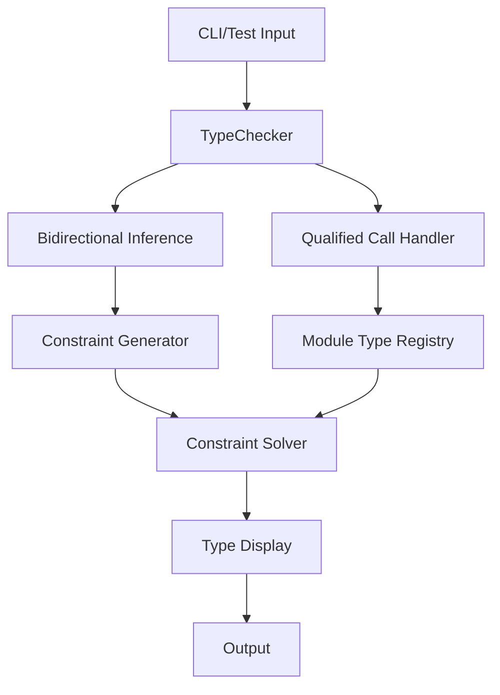

# Constraint System Regression Fixes Design

## Overview

This design addresses the systematic fixing of constraint system regressions while preserving the core polymorphic type inference achievements. The main challenge is ensuring consistent behavior across different execution paths (CLI vs tests) and fixing specific test failures without breaking the fundamental constraint-based type system.

## Architecture

### Core Components

1. **Enhanced TypeChecker**: The main type checking engine with integrated constraint generation
2. **Bidirectional Type Checker**: Specialized inference for lambda expressions with constraint analysis
3. **Constraint Solver**: Unified constraint resolution system
4. **Module Type Registry**: Concrete type mappings for qualified calls
5. **CLI Integration**: Consistent type display across execution paths

### Component Interactions



## Components and Interfaces

### Enhanced TypeChecker

**Purpose**: Main type checking orchestrator with constraint-aware inference

**Key Methods**:
- `inferLambdaBidirectionally(expr: LambdaExpression): FunkType`
- `handleQualifiedCall(expr: MemberAccess): FunkType`
- `analyzeForAbilityConstraints(body: Expression, paramTypes: Map<String, FunkType>): List<FunctionAbilityConstraint>`

**Responsibilities**:
- Route expressions to appropriate inference methods
- Coordinate between bidirectional and qualified call inference
- Maintain consistency between CLI and test execution paths

### Bidirectional Type Checker Integration

**Purpose**: Specialized lambda inference with comprehensive constraint analysis

**Key Components**:
- **Constraint Analysis**: Deep inspection of lambda bodies for arithmetic operations
- **Type Variable Mapping**: Consistent type variable assignment across contexts
- **Ability Constraint Generation**: Automatic constraint creation for polymorphic operations

**Algorithm**:
1. Parse lambda parameters and create type variables
2. Analyze lambda body for constraint-generating operations
3. Generate ability constraints based on operation types
4. Create function type with parameter record, return type, and constraints

### Qualified Call Resolution System

**Purpose**: Handle module-qualified function calls with concrete type forcing

**Components**:
- **Call Detection**: Pattern matching for `module::function` syntax
- **Module Registry**: Predefined concrete type mappings
- **Type Forcing**: Override polymorphic inference with concrete types

**Registry Structure**:
```kotlin
object ModuleTypeRegistry {
    private val concreteTypes = mapOf(
        "int::add" to FunctionType(RecordType(mapOf("left" to IntType, "right" to IntType)), IntType),
        "float::multiply" to FunctionType(RecordType(mapOf("left" to FloatType, "right" to FloatType)), FloatType),
        "string::length" to FunctionType(StringType, IntType)
    )
}
```

### Constraint Generation and Solving

**Purpose**: Unified constraint collection and resolution

**Constraint Types**:
- **Ability Constraints**: `NumAdd 'a`, `NumSub 'a`, etc.
- **Equality Constraints**: Type variable unification
- **Concrete Constraints**: Qualified call type forcing

**Resolution Strategy**:
1. Collect all constraints from expression analysis
2. Apply concrete type constraints first (qualified calls)
3. Resolve ability constraints for remaining polymorphic types
4. Unify type variables through constraint propagation

## Data Models

### Enhanced Function Type

```kotlin
data class FunctionType(
    val paramType: FunkType,
    val returnType: FunkType,
    val effects: EffectRow?,
    val abilityConstraints: List<FunctionAbilityConstraint>
) : FunkType
```

### Ability Constraint

```kotlin
data class FunctionAbilityConstraint(
    val abilityName: String,
    val typeArgs: List<FunkType.VarType>
)
```

### Constraint Context

```kotlin
data class ConstraintContext(
    val typeVariables: MutableMap<String, FunkType.VarType>,
    val constraints: MutableList<Constraint>,
    val concreteBindings: MutableMap<FunkType.VarType, FunkType>
)
```

## Error Handling

### Constraint Violation Errors

**Scenario**: Ability constraint cannot be satisfied
**Error Message**: "Type 'String' does not support ability 'NumAdd'. Required for arithmetic operation."

**Scenario**: Qualified call type mismatch
**Error Message**: "Function 'int::add' expects Int arguments, but received 'String' for parameter 'left'."

### Type Variable Consistency Errors

**Scenario**: Inconsistent type variable mapping
**Error Message**: "Internal error: Type variable 'a inconsistently mapped across constraint contexts."

### CLI vs Test Inconsistency

**Detection**: Automated validation comparing CLI and test outputs
**Resolution**: Unified type display formatting and constraint generation paths

## Testing Strategy

### Unit Testing

1. **Constraint Generation Tests**: Verify correct ability constraints for various expressions
2. **Qualified Call Tests**: Ensure concrete type forcing works correctly
3. **Bidirectional Inference Tests**: Test lambda constraint analysis
4. **Type Display Tests**: Verify consistent formatting across paths

### Integration Testing

1. **CLI Integration Tests**: Compare CLI output with expected constraint types
2. **Cross-Path Consistency Tests**: Verify same expressions produce same types
3. **Regression Tests**: Ensure fixes don't break existing functionality

### Test Categories

- **High Priority**: AddFunctionDebugTest, ArithmeticConstraintTest, CLI consistency
- **Medium Priority**: ArrayListTypeCheckerTest, effect system integration
- **Low Priority**: Error reporting, fixture compatibility

## Implementation Phases

### Phase 1: CLI Consistency Fix (Critical)
- Debug bidirectional type checker constraint generation
- Fix `analyzeForAbilityConstraints` method
- Ensure CLI displays ability constraints correctly

### Phase 2: Test Stabilization (High Priority)
- Fix AddFunctionDebugTest regression
- Resolve ArrayListTypeCheckerTest failures
- Address arithmetic constraint test issues

### Phase 3: System Integration (Medium Priority)
- Ensure effect system compatibility
- Fix do expression constraint handling
- Validate qualified call resolution

### Phase 4: Performance and Polish (Low Priority)
- Optimize constraint generation performance
- Enhance error messages
- Complete fixture test compatibility

## Performance Considerations

### Constraint Generation Overhead
- **Mitigation**: Cache qualified call type lookups
- **Optimization**: Early termination for concrete type paths
- **Monitoring**: Profile constraint analysis performance

### Memory Usage
- **Concern**: Type variable and constraint accumulation
- **Solution**: Bounded constraint contexts with cleanup
- **Validation**: Memory usage tests for large expressions

### Compilation Speed
- **Target**: No more than 10% overhead from constraint system
- **Measurement**: Benchmark against pre-constraint baseline
- **Optimization**: Lazy constraint generation where possible

## Migration Strategy

### Backward Compatibility
- Preserve existing polymorphic type inference behavior
- Maintain qualified call concrete type resolution
- Ensure no breaking changes to public APIs

### Rollback Plan
- Feature flags for constraint system components
- Fallback to original inference methods on failure
- Comprehensive test coverage for rollback scenarios

### Validation Criteria
- Less than 10 failing tests in full test suite
- CLI and test path consistency for all expressions
- No performance regression beyond 10% overhead