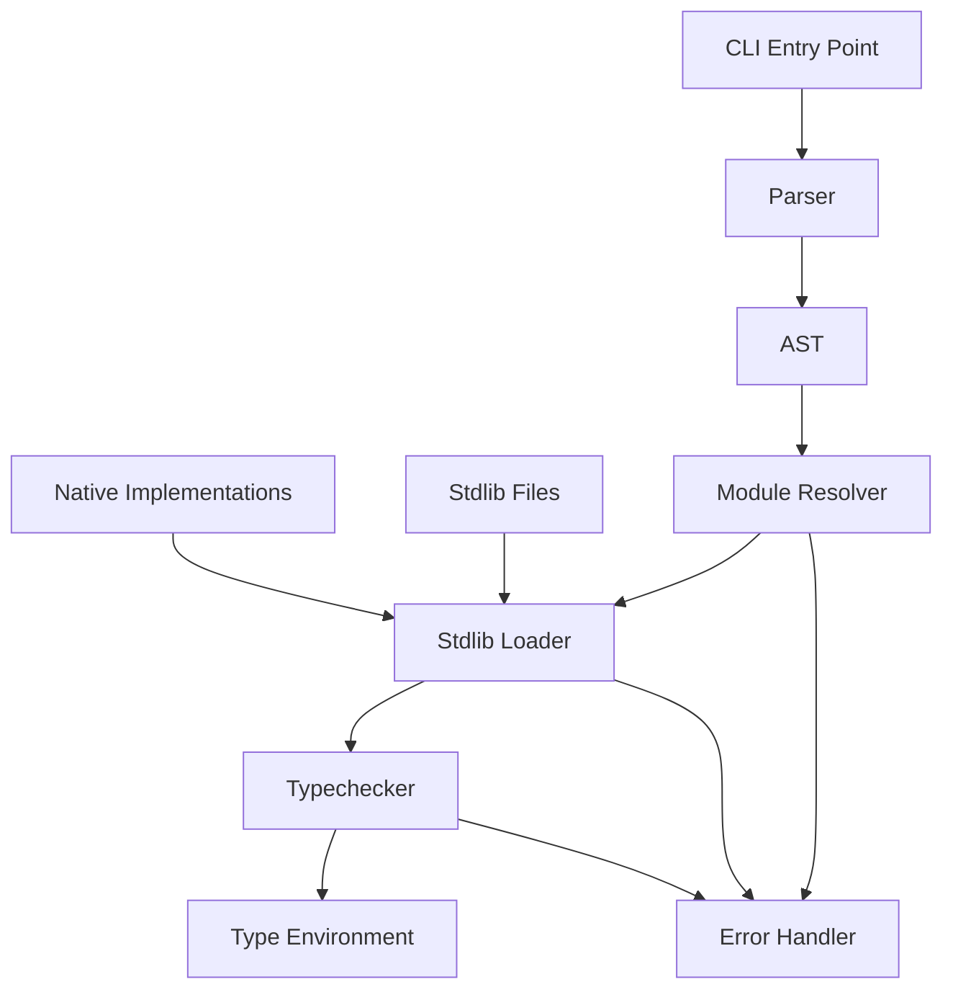

# Design Document

## Overview

This design addresses critical issues in the Funk language implementation through targeted fixes to the typechecker, parser, and stdlib integration. The solution focuses on proper error handling for undefined variables, fixing parser regressions, and establishing a robust stdlib loading mechanism.

## Architecture

### Component Interaction Flow


## Components and Interfaces

### 1. Enhanced Typechecker Error Handling

**Purpose:** Provide proper error reporting for undefined variables instead of creating fresh type variables.

**Key Changes:**
- Modify variable resolution to distinguish between undefined variables and legitimate type inference
- Add specific error types for undefined variables and missing modules
- Implement qualified name resolution with proper error reporting

**Interface:**
```kotlin
interface VariableResolver {
    fun resolveVariable(name: String, context: TypeContext): Result<Type, TypeError>
    fun resolveQualifiedName(module: String, name: String, context: TypeContext): Result<Type, TypeError>
}

sealed class TypeError {
    data class UndefinedVariable(val name: String, val location: SourceLocation) : TypeError()
    data class UndefinedModule(val module: String, val location: SourceLocation) : TypeError()
    data class UndefinedQualifiedName(val module: String, val name: String, val location: SourceLocation) : TypeError()
}
```

### 2. Stdlib Module Loading System

**Purpose:** Ensure standard library modules are properly loaded and available during type checking.

**Key Changes:**
- Implement automatic stdlib loading in the CLI and typechecker initialization
- Create fallback mechanism between parsed stdlib and inlined implementations
- Add proper error handling for stdlib loading failures

**Interface:**
```kotlin
interface StdlibLoader {
    fun loadStdlib(): Result<ModuleEnvironment, StdlibError>
    fun getInlinedImplementations(): Map<String, NativeFunction>
    fun isStdlibAvailable(): Boolean
}

class ModuleEnvironment {
    val functions: Map<String, FunctionType>
    val types: Map<String, TypeDefinition>
    val abilities: Map<String, AbilityDefinition>
}
```

### 3. Parser Regression Fixes

**Purpose:** Fix syntax parsing issues in stdlib files while maintaining backward compatibility.

**Key Changes:**
- Review and fix ANTLR grammar rules for function signatures with named parameters
- Improve error recovery for malformed syntax
- Add comprehensive parser tests for stdlib syntax patterns

**Areas to Fix:**
- Named parameter parsing in function signatures
- Operator definition syntax
- Type annotation parsing with constraints
- Array/List type syntax

### 4. Operator Implementation Correction

**Purpose:** Ensure operators follow consistent function signature patterns with named arguments.

**Key Changes:**
- Standardize operator signatures to use named argument syntax
- Update `not` function to take `{ value: Boolean }` parameter
- Fix `!=` operator implementation with proper type constraints
- Ensure inlined operators match stdlib signatures exactly

**Standard Operator Signatures:**
```funk
pub let not: { value: Boolean } -> Boolean
pub let (!=): { left: 'a, right: 'a } -> Boolean with Eq 'a
pub let (+): { left: 'a, right: 'a } -> 'a with NumAdd 'a
```

## Data Models

### Type Environment Enhancement
```kotlin
data class TypeEnvironment(
    val variables: Map<String, Type>,
    val modules: Map<String, ModuleEnvironment>,
    val inlinedFunctions: Map<String, NativeFunction>,
    val errorReporter: ErrorReporter
) {
    fun resolveVariable(name: String): Result<Type, TypeError>
    fun resolveQualifiedName(module: String, name: String): Result<Type, TypeError>
}
```

### Error Reporting System
```kotlin
interface ErrorReporter {
    fun reportUndefinedVariable(name: String, location: SourceLocation)
    fun reportUndefinedModule(module: String, location: SourceLocation)
    fun reportStdlibLoadError(error: StdlibError)
    fun reportParseError(error: ParseError)
}
```

## Error Handling

### Undefined Variable Detection
1. **Variable Resolution:** Check local scope, then module scope, then stdlib
2. **Error Generation:** Create specific error types instead of fresh type variables
3. **Error Recovery:** Continue type checking with error placeholders to find more issues

### Stdlib Loading Failures
1. **Graceful Degradation:** Fall back to inlined implementations if stdlib files fail to parse
2. **Clear Messaging:** Provide actionable error messages for stdlib issues
3. **Partial Loading:** Allow partial stdlib loading if some modules fail

### Parser Error Recovery
1. **Syntax Error Handling:** Improve error recovery to continue parsing after syntax errors
2. **Context-Aware Messages:** Provide better error messages based on parsing context
3. **Validation:** Add post-parse validation for semantic correctness

## Testing Strategy

### Unit Tests
- **Typechecker Tests:** Verify undefined variable error reporting
- **Parser Tests:** Test stdlib syntax patterns and error recovery
- **Stdlib Loader Tests:** Test loading mechanisms and fallback behavior
- **Operator Tests:** Verify correct operator signatures and behavior

### Integration Tests
- **End-to-End CLI Tests:** Test complete workflow from parsing to type checking
- **Stdlib Integration Tests:** Verify stdlib functions work correctly in user code
- **Error Reporting Tests:** Verify error messages are clear and actionable

### Regression Tests
- **Parser Regression Suite:** Ensure previously working syntax continues to work
- **Typechecker Regression Suite:** Ensure type checking behavior remains consistent
- **Stdlib Compatibility Tests:** Ensure stdlib changes don't break existing code

## Implementation Phases

### Phase 1: Typechecker Error Handling
- Implement proper undefined variable detection
- Add specific error types and reporting
- Update variable resolution logic

### Phase 2: Parser Fixes
- Fix ANTLR grammar issues
- Improve error recovery
- Add comprehensive parser tests

### Phase 3: Stdlib Integration
- Implement robust stdlib loading
- Add fallback mechanisms
- Ensure operator signatures are correct

### Phase 4: Testing and Validation
- Add comprehensive test coverage
- Validate error messages and behavior
- Performance testing for inlined vs parsed stdlib