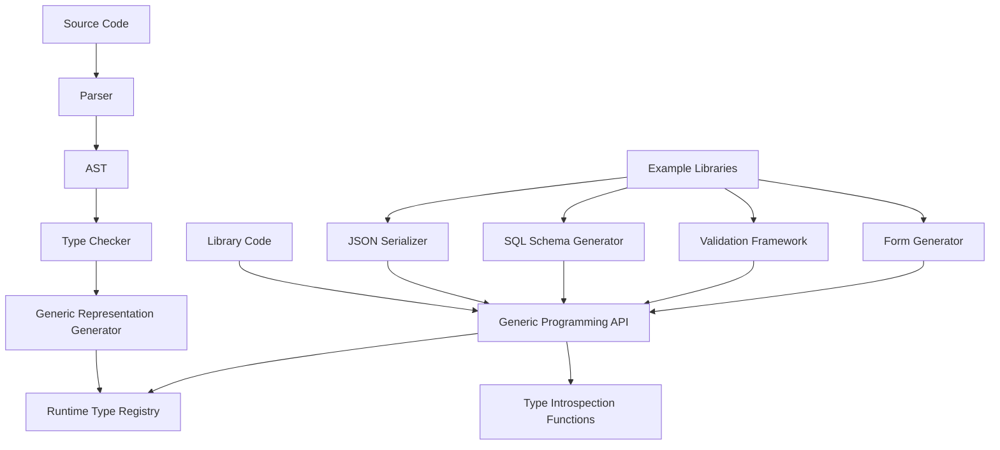
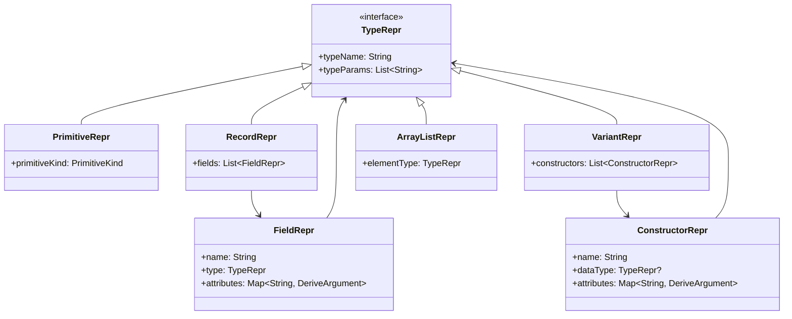
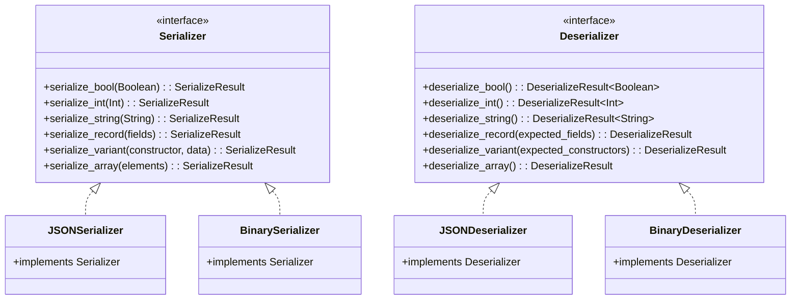

# Generic Data Representation Design Document

## Overview

This design document outlines the implementation of a built-in generic data representation system for Funk that provides runtime type introspection and structural metadata for all data types. The system exposes the internal structure of types (primitives, records, variants, collections) through a standardized API, enabling library authors to build powerful generic tools like serializers, SQL schema generators, validation frameworks, and more.

The core principle is that every type in Funk automatically has its structure available at runtime through a generic representation. This allows library authors to write code that works generically over any data type without requiring manual implementations or derive annotations. The system is inspired by Haskell's GHC.Generics and Roc's approach to structural typing.

## Architecture

### High-Level Architecture



### Core Components

1. **Generic Representation Generator**: Automatically generates structural metadata for every type
2. **Runtime Type Registry**: Global registry of all type representations accessible at runtime
3. **Generic Programming API**: Built-in functions for accessing type structure and metadata
4. **Type Introspection Functions**: Core language functions for examining type structure
5. **Library Support Framework**: APIs that enable library authors to build generic tools

## Components and Interfaces

### 1. Generic Representation System

#### No Grammar Changes Required

The existing type declaration syntax remains unchanged. Every type automatically gets generic representation:

```funk
# All types automatically get generic representation
type User = {
    name: String,
    age: Int,
    email: String
}

# Variant types have their structure exposed
type Result 'a 'e = 
    | Success { value: 'a }
    | Error { error: 'e }

# Generic types expose their parameter structure
type Container 'a = {
    items: ArrayList 'a,
    count: Int
}
```

#### Built-in Generic Programming Functions

The language provides built-in functions for accessing type structure:

```funk
# Core generic programming functions (built into the language)
let type_of: 'a -> TypeRepr = # Built-in function
let field_names: 'a -> ArrayList String = # Built-in function  
let constructor_name: 'a -> String = # Built-in function
let constructor_names: TypeRepr -> ArrayList String = # Built-in function
let field_types: TypeRepr -> ArrayList (String, TypeRepr) = # Built-in function

# Example usage by library authors:
let user = User { name = "Alice", age = 30, email = "alice@example.com" }

# Get type representation
let userType = type_of user
# userType is a value that describes the structure of User

# Get field names
let fields = field_names user
# fields = ["name", "age", "email"]

# Library authors can use this to build generic tools
let to_json = { value } -> do {
    let typeRepr = type_of value
    match typeRepr {
        | RecordRepr { fields } -> serialize_record value fields
        | VariantRepr { constructors } -> serialize_variant value constructors
        | PrimitiveRepr { kind } -> serialize_primitive value kind
        | ArrayRepr { element_type } -> serialize_array value element_type
    }
}
```

#### No AST Extensions Needed

The existing AST is sufficient. The generic representation is generated automatically during type checking without requiring any syntax changes.

### 2. Generic Representation Data Structure

#### Type Representation as Funk Values

The generic representation is exposed as regular Funk values that library authors can pattern match on:

```funk
# Built-in type representation (part of the language)
type TypeRepr = 
    | PrimitiveRepr { 
        name: String, 
        kind: PrimitiveKind 
    }
    | RecordRepr { 
        name: String, 
        type_params: ArrayList String,
        fields: ArrayList FieldRepr 
    }
    | VariantRepr { 
        name: String, 
        type_params: ArrayList String,
        constructors: ArrayList ConstructorRepr 
    }
    | ArrayRepr { 
        name: String,
        element_type: TypeRepr 
    }
    | FunctionRepr { 
        name: String,
        param_type: TypeRepr, 
        return_type: TypeRepr 
    }

type FieldRepr = {
    name: String,
    field_type: TypeRepr,
    index: Int
}

type ConstructorRepr = {
    name: String,
    tag: Int,
    data_type: TypeRepr?  # None for unit constructors
}

type PrimitiveKind = 
    | IntKind
    | FloatKind  
    | StringKind
    | BooleanKind
    | UnitKind
```

#### Automatic Generation During Type Checking

```kotlin
class TypeChecker {
    private val typeRegistry = TypeRegistry()
    private val reprGenerator = GenericReprGenerator()
    
    private fun processTypeDeclaration(item: TypeDeclaration): TypeDeclaration {
        // Existing type checking logic...
        val checkedDeclaration = validateTypeDeclaration(item)
        
        // Automatically generate generic representation
        val typeRepr = reprGenerator.generateRepr(checkedDeclaration)
        
        // Register the type representation for runtime access
        typeRegistry.register(checkedDeclaration.name, typeRepr)
        
        return checkedDeclaration
    }
}

class GenericReprGenerator {
    private val cache = mutableMapOf<String, FunkValue>()
    
    fun generateRepr(typeDecl: TypeDeclaration): FunkValue {
        val cacheKey = "${typeDecl.name}_${typeDecl.typeParams.joinToString("_")}"
        
        return cache.getOrPut(cacheKey) {
            when (val definition = typeDecl.definition) {
                is RecordDefinition -> generateRecordRepr(typeDecl, definition)
                is VariantDefinition -> generateVariantRepr(typeDecl, definition)
            }
        }
    }
    
    private fun generateRecordRepr(
        typeDecl: TypeDeclaration,
        definition: RecordDefinition
    ): FunkValue {
        val fields = definition.fields.mapIndexed { index, fieldDef ->
            FunkRecord(mapOf(
                "name" to FunkString(fieldDef.name),
                "field_type" to generateTypeRepr(fieldDef.type),
                "index" to FunkInt(index)
            ))
        }
        
        return FunkVariant(
            constructor = "RecordRepr",
            data = FunkRecord(mapOf(
                "name" to FunkString(typeDecl.name),
                "type_params" to FunkArrayList(typeDecl.typeParams.map { FunkString(it) }),
                "fields" to FunkArrayList(fields)
            ))
        )
    }
    
    private fun generateVariantRepr(
        typeDecl: TypeDeclaration,
        definition: VariantDefinition
    ): FunkValue {
        val constructors = definition.constructors.mapIndexed { index, constructorDef ->
            FunkRecord(mapOf(
                "name" to FunkString(constructorDef.name),
                "tag" to FunkInt(index),
                "data_type" to (constructorDef.dataType?.let { generateTypeRepr(it) } ?: FunkNull)
            ))
        }
        
        return FunkVariant(
            constructor = "VariantRepr",
            data = FunkRecord(mapOf(
                "name" to FunkString(typeDecl.name),
                "type_params" to FunkArrayList(typeDecl.typeParams.map { FunkString(it) }),
                "constructors" to FunkArrayList(constructors)
            ))
        )
    }
    
    private fun generateTypeRepr(typeAnnotation: TypeAnnotation): FunkValue {
        return when (typeAnnotation) {
            is IdentifierTypeAnnotation -> {
                when (typeAnnotation.name) {
                    "Int" -> FunkVariant("PrimitiveRepr", FunkRecord(mapOf(
                        "name" to FunkString("Int"),
                        "kind" to FunkVariant("IntKind", null)
                    )))
                    "String" -> FunkVariant("PrimitiveRepr", FunkRecord(mapOf(
                        "name" to FunkString("String"),
                        "kind" to FunkVariant("StringKind", null)
                    )))
                    // ... other primitives
                    else -> {
                        // Look up user-defined type
                        typeRegistry.getRepr(typeAnnotation.name)
                            ?: throw TypeReprError("Unknown type: ${typeAnnotation.name}")
                    }
                }
            }
            is TypeApplicationAnnotation -> {
                when (typeAnnotation.constructor) {
                    "ArrayList" -> {
                        val elementType = generateTypeRepr(typeAnnotation.args.first())
                        FunkVariant("ArrayRepr", FunkRecord(mapOf(
                            "name" to FunkString("ArrayList"),
                            "element_type" to elementType
                        )))
                    }
                    else -> throw TypeReprError("Unsupported type application: ${typeAnnotation.constructor}")
                }
            }
            else -> throw TypeReprError("Unsupported type annotation: ${typeAnnotation::class.simpleName}")
        }
    }
}
```

### 3. Funk-Style Generic Programming API

#### How Library Authors Access Type Information

Instead of explicit `type_of` functions, Funk provides type information through the ability system and compile-time type resolution:

```funk
# The compiler automatically makes TypeRepr available for any type 'a
# through a built-in ability that every type implements

ability Generic 'a {
    type_repr: {} -> TypeRepr,
    field_names: {} -> ArrayList String,
    constructor_names: {} -> ArrayList String
}

# Every type automatically implements Generic
# impl Generic for User { ... }  # Generated by compiler
# impl Generic for Result 'a 'e { ... }  # Generated by compiler

# Library authors can use Generic ability constraints
let serialize_any: 'a -> String where { Generic 'a } = { value } -> do {
    let type_info = Generic.type_repr {}
    serialize_with_repr value type_info
}
```

#### Real-World Library Example: JSON Module

Here's how a 3rd party JSON library would actually work:

```funk
# json.funk - A 3rd party JSON serialization library

# Core encoding function - works with any type that implements Generic
pub let encode: 'a -> String where { Generic 'a } = { value } -> do {
    let type_info = Generic.type_repr {}
    encode_value value type_info
}

# Core decoding function - uses type information to construct the right type
pub let decode: { str: String } -> Result 'a String where { Generic 'a } = { str } -> do {
    let type_info = Generic.type_repr {}
    let parsed = parse_json str
    decode_value parsed type_info
}

# Decoding with configuration
pub let decode_with: { str: String, config: DecodeConfig } -> Result 'a String where { Generic 'a } = 
{ str, config } -> do {
    let type_info = Generic.type_repr {}
    let parsed = parse_json str
    decode_value_with_config parsed type_info config
}

# Configuration for customizing decoding behavior
pub type DecodeConfig = {
    name_transform: NameTransform,
    ignore_unknown_fields: Boolean,
    strict_types: Boolean
}

pub type NameTransform = 
    | CamelCase
    | SnakeCase  
    | Lowercase
    | Custom { transform: String -> String }

# Internal implementation using TypeRepr
let encode_value = { value, type_repr } ->
    match type_repr {
        | PrimitiveRepr { kind } -> encode_primitive value kind
        | RecordRepr { fields } -> encode_record value fields
        | VariantRepr { constructors } -> encode_variant value constructors  
        | ArrayRepr { element_type } -> encode_array value element_type
        | FunctionRepr _ -> error "Cannot encode functions to JSON"
    }

let decode_value_with_config = { json_value, type_repr, config } ->
    match type_repr {
        | PrimitiveRepr { kind } -> decode_primitive json_value kind
        | RecordRepr { fields } -> decode_record json_value fields config
        | VariantRepr { constructors } -> decode_variant json_value constructors config
        | ArrayRepr { element_type } -> decode_array json_value element_type config
        | FunctionRepr _ -> error "Cannot decode functions from JSON"
    }

let decode_record = { json_obj, fields, config } -> do {
    let field_values = fields |> map { field ->
        let json_field_name = transform_field_name field.name config.name_transform
        let json_value = get_json_field json_obj json_field_name
        
        match json_value {
            | Some value -> do {
                let decoded = decode_value_with_config value field.field_type config
                match decoded {
                    | Ok { value } -> Ok { field_name = field.name, value = value }
                    | Err { error } -> Err { error = "Field " + field.name + ": " + error }
                }
            }
            | None -> Err { error = "Missing required field: " + field.name }
        }
    }
    
    # Construct the record from decoded field values
    construct_record field_values type_repr
}
```

#### Usage Examples

```funk
# User code - clean and simple
use json::{encode, decode, decode_with, DecodeConfig, CamelCase}

type User = {
    user_name: String,
    age: Int,
    is_active: Boolean
}

type ApiResponse 'a = 
    | Success { data: 'a }
    | Error { message: String, code: Int }

# Encoding - just works automatically
let user = User { user_name = "alice", age = 30, is_active = true }
let json_str = encode user
# Result: {"user_name":"alice","age":30,"is_active":true}

# Basic decoding
let decoded_user: Result User String = decode { str = json_str }

# Decoding with configuration for API compatibility
let api_json = "{\"userName\":\"bob\",\"age\":25,\"isActive\":false}"
let config = DecodeConfig { 
    name_transform = CamelCase, 
    ignore_unknown_fields = true,
    strict_types = false 
}
let api_user: Result User String = decode_with { str = api_json, config = config }

# Works with generic types too
let response_json = "{\"tag\":\"Success\",\"data\":{\"userName\":\"charlie\",\"age\":35,\"isActive\":true}}"
let response: Result (ApiResponse User) String = decode_with { str = response_json, config = config }
```

#### How the Compiler Enables This

The compiler automatically generates `Generic` implementations:

```kotlin
// Generated by compiler for User type
impl Generic for User {
    type_repr = {} -> RecordRepr {
        name = "User",
        type_params = [],
        fields = [
            FieldRepr { name = "user_name", field_type = PrimitiveRepr { name = "String", kind = StringKind }, index = 0 },
            FieldRepr { name = "age", field_type = PrimitiveRepr { name = "Int", kind = IntKind }, index = 1 },
            FieldRepr { name = "is_active", field_type = PrimitiveRepr { name = "Boolean", kind = BooleanKind }, index = 2 }
        ]
    }
    
    field_names = {} -> ["user_name", "age", "is_active"]
    
    constructor_names = {} -> []  # Records don't have constructors
}
```

### 4. Runtime Type Registry

#### Type Registry Implementation

The runtime maintains a global registry of all type representations:

```kotlin
class TypeRegistry {
    private val typeReprs = mutableMapOf<String, FunkValue>()
    private val typeInstances = mutableMapOf<String, FunkValue>()
    
    fun register(typeName: String, repr: FunkValue) {
        typeReprs[typeName] = repr
    }
    
    fun getRepr(typeName: String): FunkValue? {
        return typeReprs[typeName]
    }
    
    fun getAllTypes(): Map<String, FunkValue> {
        return typeReprs.toMap()
    }
    
    // Built-in function implementations
    fun typeOf(value: FunkValue): FunkValue {
        return when (value) {
            is FunkInt -> primitiveRepr("Int", "IntKind")
            is FunkString -> primitiveRepr("String", "StringKind")
            is FunkBoolean -> primitiveRepr("Boolean", "BooleanKind")
            is FunkRecord -> {
                // Look up the record type representation
                val typeName = value.typeName ?: "AnonymousRecord"
                typeReprs[typeName] ?: generateAnonymousRecordRepr(value)
            }
            is FunkVariant -> {
                // Look up the variant type representation
                val typeName = value.typeName ?: "AnonymousVariant"
                typeReprs[typeName] ?: generateAnonymousVariantRepr(value)
            }
            is FunkArrayList -> {
                // Generate array representation with element type
                val elementType = if (value.elements.isNotEmpty()) {
                    typeOf(value.elements.first())
                } else {
                    primitiveRepr("Unknown", "UnitKind")
                }
                
                FunkVariant("ArrayRepr", FunkRecord(mapOf(
                    "name" to FunkString("ArrayList"),
                    "element_type" to elementType
                )))
            }
            else -> primitiveRepr("Unknown", "UnitKind")
        }
    }
    
    fun fieldNames(value: FunkValue): FunkValue {
        return when (value) {
            is FunkRecord -> {
                FunkArrayList(value.fields.keys.map { FunkString(it) })
            }
            else -> FunkArrayList(emptyList())
        }
    }
    
    fun constructorName(value: FunkValue): FunkValue {
        return when (value) {
            is FunkVariant -> FunkString(value.constructor)
            else -> FunkString("NotAVariant")
        }
    }
    
    fun getField(value: FunkValue, fieldName: String): FunkValue {
        return when (value) {
            is FunkRecord -> value.fields[fieldName] ?: FunkNull
            else -> FunkNull
        }
    }
    
    fun setField(value: FunkValue, fieldName: String, newValue: FunkValue): FunkValue {
        return when (value) {
            is FunkRecord -> {
                val newFields = value.fields.toMutableMap()
                newFields[fieldName] = newValue
                FunkRecord(newFields, value.typeName)
            }
            else -> value
        }
    }
    
    fun getConstructorData(value: FunkValue): FunkValue {
        return when (value) {
            is FunkVariant -> value.data ?: FunkNull
            else -> FunkNull
        }
    }
    
    private fun primitiveRepr(name: String, kind: String): FunkValue {
        return FunkVariant("PrimitiveRepr", FunkRecord(mapOf(
            "name" to FunkString(name),
            "kind" to FunkVariant(kind, null)
        )))
    }
}
```

#### Built-in Function Integration

The generic programming functions are integrated into the interpreter:

```kotlin
class FunkInterpreter {
    private val typeRegistry = TypeRegistry()
    
    // Built-in function implementations
    private fun setupBuiltinFunctions() {
        context["type_of"] = SimpleFunkFunction { args ->
            val value = args["value"] ?: throw RuntimeException("Missing value argument")
            typeRegistry.typeOf(value)
        }
        
        context["field_names"] = SimpleFunkFunction { args ->
            val value = args["value"] ?: throw RuntimeException("Missing value argument")
            typeRegistry.fieldNames(value)
        }
        
        context["constructor_name"] = SimpleFunkFunction { args ->
            val value = args["value"] ?: throw RuntimeException("Missing value argument")
            typeRegistry.constructorName(value)
        }
        
        context["get_field"] = SimpleFunkFunction { args ->
            val value = args["value"] ?: throw RuntimeException("Missing value argument")
            val fieldName = (args["field_name"] as? FunkString)?.value 
                ?: throw RuntimeException("Missing or invalid field_name argument")
            typeRegistry.getField(value, fieldName)
        }
        
        context["set_field"] = SimpleFunkFunction { args ->
            val value = args["value"] ?: throw RuntimeException("Missing value argument")
            val fieldName = (args["field_name"] as? FunkString)?.value 
                ?: throw RuntimeException("Missing or invalid field_name argument")
            val newValue = args["new_value"] ?: throw RuntimeException("Missing new_value argument")
            typeRegistry.setField(value, fieldName, newValue)
        }
        
        context["get_constructor_data"] = SimpleFunkFunction { args ->
            val value = args["value"] ?: throw RuntimeException("Missing value argument")
            typeRegistry.getConstructorData(value)
        }
    }
}
```

### 5. More Library Examples

#### SQL ORM Library

```funk
# sql_orm.funk - Database ORM using generic representation
use database::{Connection, execute, query}

# Generic table creation
pub let create_table: { conn: Connection, table_name: String } -> Result Unit String where { Generic 'a } = 
{ conn, table_name } -> do {
    let type_info = Generic.type_repr {}
    let schema = generate_schema type_info table_name
    execute conn schema
}

# Generic insert
pub let insert: { conn: Connection, table_name: String, record: 'a } -> Result Unit String where { Generic 'a } = 
{ conn, table_name, record } -> do {
    let type_info = Generic.type_repr {}
    let insert_sql = generate_insert type_info table_name record
    execute conn insert_sql
}

# Generic select
pub let select_all: { conn: Connection, table_name: String } -> Result (ArrayList 'a) String where { Generic 'a } = 
{ conn, table_name } -> do {
    let type_info = Generic.type_repr {}
    let select_sql = "SELECT * FROM " + table_name
    let rows = query conn select_sql
    
    match rows {
        | Ok { value = row_data } -> do {
            let records = row_data |> map { row -> construct_from_row row type_info }
            Ok { value = records }
        }
        | Err { error } -> Err { error = error }
    }
}

# Usage:
type User = { id: Int, name: String, email: String }

let conn = connect_to_database "users.db"
let _ = create_table { conn = conn, table_name = "users" }
let _ = insert { conn = conn, table_name = "users", record = User { id = 1, name = "Alice", email = "alice@example.com" } }
let users: Result (ArrayList User) String = select_all { conn = conn, table_name = "users" }
```

#### Validation Library

```funk
# validation.funk - Generic validation framework
pub type ValidationRule 'a = 
    | Required
    | MinLength { min: Int }
    | MaxLength { max: Int }
    | Range { min: 'a, max: 'a }
    | Custom { validator: 'a -> Boolean, message: String }

pub type ValidationError = {
    field: String,
    message: String
}

pub type ValidationResult = 
    | Valid
    | Invalid { errors: ArrayList ValidationError }

# Generic validation that works on any record type
pub let validate: { value: 'a, rules: 'a -> ArrayList (String, ArrayList (ValidationRule 'b)) } -> ValidationResult where { Generic 'a } = 
{ value, rules } -> do {
    let type_info = Generic.type_repr {}
    
    match type_info {
        | RecordRepr { fields } -> do {
            let field_rules = rules value
            let errors = []
            
            fields |> for_each { field ->
                let field_value = get_record_field value field.name
                let field_rule_list = field_rules |> find { (name, _) -> name == field.name }
                
                match field_rule_list {
                    | Some (_, rules) -> do {
                        let field_errors = validate_field field_value rules field.name
                        errors |> append_all field_errors
                    }
                    | None -> {}
                }
            }
            
            if is_empty errors then Valid else Invalid { errors = errors }
        }
        | _ -> Valid
    }
}

# Usage:
type CreateUserRequest = {
    name: String,
    email: String,
    age: Int
}

let user_validation_rules = { request } -> [
    ("name", [Required, MinLength { min = 2 }, MaxLength { max = 50 }]),
    ("email", [Required, Custom { validator = is_valid_email, message = "Invalid email format" }]),
    ("age", [Required, Range { min = 18, max = 120 }])
]

let request = CreateUserRequest { name = "A", email = "invalid", age = 15 }
let result = validate { value = request, rules = user_validation_rules }
# Result: Invalid { errors = [
#   { field = "name", message = "Minimum length is 2" },
#   { field = "email", message = "Invalid email format" },
#   { field = "age", message = "Value must be between 18 and 120" }
# ]}
```

#### GraphQL Schema Generator

```funk
# graphql.funk - Generate GraphQL schemas from Funk types
pub let generate_graphql_schema: { type_name: String } -> String where { Generic 'a } = 
{ type_name } -> do {
    let type_info = Generic.type_repr {}
    generate_type_definition type_info type_name
}

let generate_type_definition = { type_repr, type_name } ->
    match type_repr {
        | RecordRepr { fields } -> do {
            let field_definitions = fields |> map { field ->
                let graphql_type = funk_type_to_graphql_type field.field_type
                "  " + field.name + ": " + graphql_type
            }
            
            "type " + type_name + " {\n" + join field_definitions "\n" + "\n}"
        }
        | VariantRepr { constructors } -> do {
            let union_types = constructors |> map { constructor ->
                type_name + constructor.name
            }
            
            "union " + type_name + " = " + join union_types " | "
        }
        | _ -> error "Only record and variant types can be converted to GraphQL"
    }

# Usage:
type User = { id: String, name: String, posts: ArrayList Post }
type Post = { id: String, title: String, content: String }

let user_schema = generate_graphql_schema { type_name = "User" }
# Result: 
# type User {
#   id: String
#   name: String  
#   posts: [Post]
# }
```

#### Configuration Library

```funk
# config.funk - Load configuration from various sources using type structure
pub let load_from_env: {} -> Result 'a String where { Generic 'a } = {} -> do {
    let type_info = Generic.type_repr {}
    load_config_from_source type_info EnvironmentSource
}

pub let load_from_file: { path: String } -> Result 'a String where { Generic 'a } = { path } -> do {
    let type_info = Generic.type_repr {}
    load_config_from_source type_info (FileSource { path = path })
}

type ConfigSource = 
    | EnvironmentSource
    | FileSource { path: String }
    | CommandLineSource { args: ArrayList String }

# Usage:
type DatabaseConfig = {
    host: String,
    port: Int,
    username: String,
    password: String,
    database_name: String
}

# Automatically loads from environment variables:
# DB_HOST, DB_PORT, DB_USERNAME, DB_PASSWORD, DB_DATABASE_NAME
let db_config: Result DatabaseConfig String = load_from_env {}

# Or from a config file
let db_config_from_file: Result DatabaseConfig String = load_from_file { path = "database.json" }
```

## Data Models

### Type Representation Hierarchy



### Serialization Framework Architecture



## Error Handling

### Compile-Time Error Detection

```kotlin
sealed class DeriveError : Exception() {
    data class UnsupportedType(
        val typeName: String,
        val reason: String
    ) : DeriveError() {
        override val message = "Cannot derive serialization for type '$typeName': $reason"
    }
    
    data class MissingDependency(
        val typeName: String,
        val dependencyType: String,
        val missingAbility: String
    ) : DeriveError() {
        override val message = "Cannot derive $missingAbility for '$typeName' because field type '$dependencyType' does not implement $missingAbility"
    }
    
    data class CircularReference(
        val typeName: String,
        val cycle: List<String>
    ) : DeriveError() {
        override val message = "Circular reference detected in type '$typeName': ${cycle.joinToString(" -> ")}"
    }
    
    data class ConflictingAttributes(
        val typeName: String,
        val fieldName: String,
        val conflicts: List<String>
    ) : DeriveError() {
        override val message = "Conflicting serialization attributes on field '$fieldName' in type '$typeName': ${conflicts.joinToString(", ")}"
    }
}
```

### Runtime Error Handling

```funk
type SerializeError = 
    | TypeMismatch { expected: String, actual: String }
    | MissingField { fieldName: String }
    | InvalidValue { value: String, reason: String }
    | FormatError { message: String }

type DeserializeError =
    | ParseError { message: String, position: Int }
    | UnknownConstructor { constructor: String, validConstructors: ArrayList String }
    | MissingRequiredField { fieldName: String }
    | TypeMismatch { expected: String, actual: String }
    | InvalidFormat { expected: String, actual: String }
```

## Testing Strategy

### Unit Testing Framework

```funk
# Test utilities for serialization
ability SerializeTest 'a where { Serialize 'a, Deserialize 'a } {
    roundtrip_test: { value: 'a, serializer: Serializer, deserializer: Deserializer } -> TestResult
}

impl SerializeTest for 'a where { Serialize 'a, Deserialize 'a } {
    roundtrip_test = { value, serializer, deserializer } -> do {
        let serialized = Serialize.serialize { value = value, serializer = serializer }
        match serialized {
            | SerializeError { message } -> TestFailure { reason = "Serialization failed: " + message }
            | SerializeSuccess { data } -> do {
                # Create deserializer from serialized data
                let inputDeserializer = createDeserializer { data = data, deserializer = deserializer }
                let deserialized = Deserialize.deserialize { deserializer = inputDeserializer }
                match deserialized {
                    | DeserializeError { message } -> TestFailure { reason = "Deserialization failed: " + message }
                    | DeserializeSuccess { value = newValue } -> 
                        if value == newValue 
                        then TestSuccess
                        else TestFailure { reason = "Values don't match after roundtrip" }
                }
            }
        }
    }
}
```

### Integration Testing

```funk
# Example test cases
type TestUser derive(Serialize, Deserialize) = {
    id: Int,
    name: String,
    active: Boolean
}

let testUser = TestUser { id = 123, name = "Alice", active = true }

# JSON roundtrip test
let jsonTest = SerializeTest.roundtrip_test { 
    value = testUser, 
    serializer = jsonSerializer, 
    deserializer = jsonDeserializer 
}

# Binary roundtrip test  
let binaryTest = SerializeTest.roundtrip_test {
    value = testUser,
    serializer = binarySerializer,
    deserializer = binaryDeserializer
}
```

### Property-Based Testing

```funk
# Property: serialization should be deterministic
ability DeterministicSerialize 'a where { Serialize 'a } {
    deterministic_test: { value: 'a, serializer: Serializer } -> TestResult
}

impl DeterministicSerialize for 'a where { Serialize 'a } {
    deterministic_test = { value, serializer } -> do {
        let result1 = Serialize.serialize { value = value, serializer = serializer }
        let result2 = Serialize.serialize { value = value, serializer = serializer }
        
        match (result1, result2) {
            | (SerializeSuccess { data = data1 }, SerializeSuccess { data = data2 }) ->
                if data1.data == data2.data
                then TestSuccess
                else TestFailure { reason = "Serialization is not deterministic" }
            | _ -> TestFailure { reason = "Serialization failed" }
        }
    }
}
```

## Performance Considerations

### Compile-Time Optimizations

1. **Memoization**: Cache generated type representations to avoid recomputation
2. **Incremental Generation**: Only regenerate implementations when type definitions change
3. **Dead Code Elimination**: Only generate serialization code for types that are actually serialized

### Runtime Optimizations

1. **Inlining**: Inline simple serialization operations for primitive types
2. **Specialization**: Generate specialized implementations for common cases
3. **Lazy Loading**: Load type metadata only when needed

### Memory Optimizations

1. **Interning**: Intern field names and constructor names to reduce memory usage
2. **Compact Representations**: Use efficient data structures for type metadata
3. **Streaming**: Support streaming serialization for large data structures

## Migration and Compatibility

### Backward Compatibility

- Existing code without `derive` annotations continues to work unchanged
- Manual ability implementations take precedence over derived ones
- Gradual adoption path: types can be migrated to use `derive` incrementally

### Version Compatibility

- Serialized data includes format version information
- Support for multiple format versions in deserializers
- Clear migration path for format changes

### Interoperability

- JSON format compatible with standard JSON parsers
- Binary format designed for cross-language compatibility
- Custom format support for domain-specific requirements

This design provides a comprehensive foundation for implementing generic data representation in Funk while maintaining the language's principles of type safety, performance, and developer ergonomics.