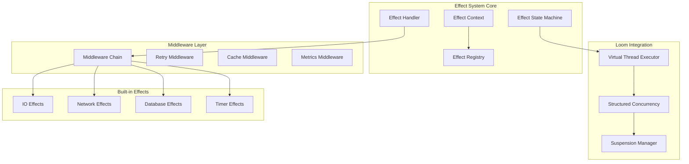

# Design Document

## Overview

This design document outlines a comprehensive redesign of Funk's effect system built on state machines with Project Loom virtual threads. The new system addresses the current limitations by providing async-by-default effects, abort/resume capabilities, structured concurrency, and enhanced developer experience through better error messages and testing support.

The design follows the principles of algebraic effects while leveraging modern JVM capabilities to provide world-class performance and developer ergonomics.

## Architecture

### High-Level Architecture



### Core Components

#### 1. Effect State Machine (ESM)

The Effect State Machine is the heart of the new system, compiling effect-heavy code into efficient state machines similar to Rust's async/await model.

```kotlin
sealed class EffectState(val id: String) {
    data class ComputeState(
        override val id: String,
        val computation: (EffectContext) -> FunkValue
    ) : EffectState(id)
    
    data class AsyncEffectState(
        override val id: String,
        val effectCall: EffectCall,
        val nextStateId: String
    ) : EffectState(id)
    
    data class JoinState(
        override val id: String,
        val futureIds: List<String>,
        val combiner: (List<FunkValue>) -> FunkValue,
        val nextStateId: String
    ) : EffectState(id)
    
    data class RaceState(
        override val id: String,
        val futureIds: List<String>,
        val nextStateId: String
    ) : EffectState(id)
    
    data class ConditionalState(
        override val id: String,
        val condition: (EffectContext) -> Boolean,
        val thenStateId: String,
        val elseStateId: String
    ) : EffectState(id)
    
    data class SuspensionState(
        override val id: String,
        val suspensionPoint: SuspensionPoint,
        val nextStateId: String
    ) : EffectState(id)
}

class EffectStateMachine(
    val id: String,
    val states: Map<String, EffectState>,
    val initialStateId: String,
    val finalStateId: String
) {
    suspend fun execute(context: EffectContext): FunkValue {
        var currentStateId = initialStateId
        var executionContext = context
        
        while (currentStateId != finalStateId) {
            val state = states[currentStateId] 
                ?: throw EffectExecutionError("State not found: $currentStateId")
            
            val result = executeState(state, executionContext)
            
            when (result) {
                is StateTransition -> {
                    currentStateId = result.nextStateId
                    executionContext = result.context
                }
                is StateSuspension -> {
                    return suspendAndResume(result, executionContext)
                }
                is StateCompletion -> {
                    return result.value
                }
                is StateError -> {
                    throw EffectExecutionError("State execution failed: ${result.error}")
                }
            }
        }
        
        return executionContext.getResult() ?: FunkNull
    }
}
```

#### 2. Effect Context

A unified, immutable context that manages handler resolution and execution state.

```kotlin
data class EffectContext(
    val declaredEffects: Set<String>,
    val activeHandlers: Map<String, EffectHandler>,
    val handlerStack: List<Map<String, EffectHandler>>,
    val globalHandlers: Map<String, EffectHandler>,
    val localVariables: Map<String, FunkValue>,
    val suspensionPoints: Map<String, SuspensionPoint>,
    val executionId: String = UUID.randomUUID().toString()
) {
    fun withHandlers(handlers: Map<String, EffectHandler>): EffectContext {
        return copy(handlerStack = handlerStack + handlers)
    }
    
    fun withVariable(name: String, value: FunkValue): EffectContext {
        return copy(localVariables = localVariables + (name to value))
    }
    
    fun resolveHandler(effectName: String): EffectHandler? {
        return handlerStack.lastOrNull()?.get(effectName)
            ?: activeHandlers[effectName]
            ?: globalHandlers[effectName]
    }
    
    fun isEffectDeclared(effectName: String): Boolean {
        return effectName in declaredEffects
    }
    
    fun hasHandler(effectName: String): Boolean {
        return resolveHandler(effectName) != null
    }
    
    fun suspend(suspensionPoint: SuspensionPoint): EffectContext {
        return copy(suspensionPoints = suspensionPoints + (suspensionPoint.id to suspensionPoint))
    }
    
    fun resume(suspensionId: String, value: FunkValue): EffectContext {
        val suspensionPoint = suspensionPoints[suspensionId]
            ?: throw EffectExecutionError("Suspension point not found: $suspensionId")
        
        return suspensionPoint.resume(value, this)
    }
}
```

#### 3. Virtual Thread Executor

Manages virtual threads using Project Loom's structured concurrency.

```kotlin
class VirtualThreadEffectExecutor {
    private val virtualThreadFactory = Thread.ofVirtual()
        .name("funk-effect-", 0)
        .factory()
    
    suspend fun <T> executeAsync(task: suspend () -> T): T {
        return withContext(Dispatchers.Loom) {
            task()
        }
    }
    
    suspend fun <T> executeParallel(tasks: List<suspend () -> T>): List<T> {
        return coroutineScope {
            tasks.map { task ->
                async(Dispatchers.Loom) { task() }
            }.awaitAll()
        }
    }
    
    suspend fun <T> executeRace(tasks: List<suspend () -> T>): T {
        return coroutineScope {
            select {
                tasks.forEach { task ->
                    async(Dispatchers.Loom) { task() }.onAwait { it }
                }
            }
        }
    }
    
    suspend fun <T> executeWithTimeout(
        timeout: Duration,
        task: suspend () -> T
    ): T {
        return withTimeout(timeout) {
            withContext(Dispatchers.Loom) {
                task()
            }
        }
    }
}

// Custom Loom dispatcher
object Dispatchers {
    val Loom = Executors.newVirtualThreadPerTaskExecutor().asCoroutineDispatcher()
}
```

#### 4. Suspension and Resume System

Handles abort and resume capabilities for effect operations.

```kotlin
data class SuspensionPoint(
    val id: String,
    val stateMachineId: String,
    val currentStateId: String,
    val context: EffectContext,
    val continuationCallback: (FunkValue, EffectContext) -> EffectContext,
    val abortCallback: (Throwable, EffectContext) -> EffectContext,
    val timestamp: Long = System.currentTimeMillis()
) {
    fun resume(value: FunkValue, context: EffectContext): EffectContext {
        return continuationCallback(value, context)
    }
    
    fun abort(error: Throwable, context: EffectContext): EffectContext {
        return abortCallback(error, context)
    }
}

class SuspensionManager {
    private val suspensions = ConcurrentHashMap<String, SuspensionPoint>()
    private val timeouts = ConcurrentHashMap<String, ScheduledFuture<*>>()
    private val scheduler = Executors.newScheduledThreadPool(1)
    
    fun suspend(
        stateMachineId: String,
        stateId: String,
        context: EffectContext,
        timeout: Duration? = null
    ): SuspensionPoint {
        val suspensionId = UUID.randomUUID().toString()
        val suspensionPoint = SuspensionPoint(
            id = suspensionId,
            stateMachineId = stateMachineId,
            currentStateId = stateId,
            context = context,
            continuationCallback = { value, ctx -> ctx.withVariable("suspension_result", value) },
            abortCallback = { error, ctx -> ctx.withVariable("suspension_error", FunkString(error.message ?: "Unknown error")) }
        )
        
        suspensions[suspensionId] = suspensionPoint
        
        // Set up timeout if specified
        timeout?.let { duration ->
            val timeoutTask = scheduler.schedule({
                abort(suspensionId, TimeoutException("Suspension timed out after $duration"))
            }, duration.toMillis(), TimeUnit.MILLISECONDS)
            
            timeouts[suspensionId] = timeoutTask
        }
        
        return suspensionPoint
    }
    
    fun resume(suspensionId: String, value: FunkValue): EffectContext? {
        val suspensionPoint = suspensions.remove(suspensionId) ?: return null
        timeouts.remove(suspensionId)?.cancel(false)
        
        return suspensionPoint.resume(value, suspensionPoint.context)
    }
    
    fun abort(suspensionId: String, error: Throwable): EffectContext? {
        val suspensionPoint = suspensions.remove(suspensionId) ?: return null
        timeouts.remove(suspensionId)?.cancel(false)
        
        return suspensionPoint.abort(error, suspensionPoint.context)
    }
    
    fun listActiveSuspensions(): List<SuspensionPoint> {
        return suspensions.values.toList()
    }
}
```

## Components and Interfaces

### Effect Registry

Centralized registry for effect declarations and handler factories.

```kotlin
interface EffectRegistry {
    fun declareEffect(name: String, operations: Set<String>)
    fun registerHandler(effectName: String, handler: EffectHandler)
    fun registerHandlerFactory(effectName: String, factory: () -> EffectHandler)
    fun isEffectDeclared(effectName: String): Boolean
    fun hasHandler(effectName: String): Boolean
    fun getHandler(effectName: String): EffectHandler?
    fun getAvailableEffects(): Set<String>
    fun getAvailableOperations(effectName: String): Set<String>
}

class DefaultEffectRegistry : EffectRegistry {
    private val declaredEffects = ConcurrentHashMap<String, Set<String>>()
    private val handlers = ConcurrentHashMap<String, EffectHandler>()
    private val handlerFactories = ConcurrentHashMap<String, () -> EffectHandler>()
    
    override fun declareEffect(name: String, operations: Set<String>) {
        declaredEffects[name] = operations
    }
    
    override fun registerHandler(effectName: String, handler: EffectHandler) {
        handlers[effectName] = handler
    }
    
    override fun registerHandlerFactory(effectName: String, factory: () -> EffectHandler) {
        handlerFactories[effectName] = factory
    }
    
    override fun isEffectDeclared(effectName: String): Boolean {
        return effectName in declaredEffects
    }
    
    override fun hasHandler(effectName: String): Boolean {
        return effectName in handlers || effectName in handlerFactories
    }
    
    override fun getHandler(effectName: String): EffectHandler? {
        return handlers[effectName] ?: handlerFactories[effectName]?.invoke()?.also {
            handlers[effectName] = it
        }
    }
    
    override fun getAvailableEffects(): Set<String> {
        return declaredEffects.keys
    }
    
    override fun getAvailableOperations(effectName: String): Set<String> {
        return declaredEffects[effectName] ?: emptySet()
    }
}
```

### Effect Handler Interface

```kotlin
interface EffectHandler {
    val effectName: String
    val operations: Map<String, EffectOperation>
    
    suspend fun handle(operation: String, arguments: FunkValue, context: EffectContext): FunkValue
    fun supportsOperation(operation: String): Boolean
    fun getAvailableOperations(): Set<String>
}

interface EffectOperation {
    val name: String
    val isAsync: Boolean
    
    suspend fun execute(arguments: FunkValue, context: EffectContext): FunkValue
}

class AsyncEffectOperation(
    override val name: String,
    private val implementation: suspend (FunkValue, EffectContext) -> FunkValue
) : EffectOperation {
    override val isAsync = true
    
    override suspend fun execute(arguments: FunkValue, context: EffectContext): FunkValue {
        return implementation(arguments, context)
    }
}

class SyncEffectOperation(
    override val name: String,
    private val implementation: (FunkValue, EffectContext) -> FunkValue
) : EffectOperation {
    override val isAsync = false
    
    override suspend fun execute(arguments: FunkValue, context: EffectContext): FunkValue {
        return implementation(arguments, context)
    }
}
```

### Middleware System

```kotlin
interface EffectMiddleware {
    val name: String
    val priority: Int
    
    suspend fun intercept(
        call: EffectCall,
        next: suspend (EffectCall) -> FunkValue
    ): FunkValue
}

class MiddlewareChain(private val middlewares: List<EffectMiddleware>) {
    suspend fun execute(
        call: EffectCall,
        finalHandler: suspend (EffectCall) -> FunkValue
    ): FunkValue {
        val sortedMiddlewares = middlewares.sortedBy { it.priority }
        return executeRecursive(0, call, sortedMiddlewares, finalHandler)
    }
    
    private suspend fun executeRecursive(
        index: Int,
        call: EffectCall,
        middlewares: List<EffectMiddleware>,
        finalHandler: suspend (EffectCall) -> FunkValue
    ): FunkValue {
        return if (index >= middlewares.size) {
            finalHandler(call)
        } else {
            middlewares[index].intercept(call) { nextCall ->
                executeRecursive(index + 1, nextCall, middlewares, finalHandler)
            }
        }
    }
}

// Built-in middleware implementations
class RetryMiddleware(
    private val maxRetries: Int = 3,
    private val backoffStrategy: BackoffStrategy = ExponentialBackoff()
) : EffectMiddleware {
    override val name = "retry"
    override val priority = 100
    
    override suspend fun intercept(
        call: EffectCall,
        next: suspend (EffectCall) -> FunkValue
    ): FunkValue {
        var lastException: Exception? = null
        
        repeat(maxRetries + 1) { attempt ->
            try {
                return next(call)
            } catch (e: Exception) {
                lastException = e
                if (attempt < maxRetries && isRetryable(e)) {
                    delay(backoffStrategy.getDelay(attempt))
                } else {
                    throw e
                }
            }
        }
        
        throw lastException ?: RuntimeException("All retry attempts failed")
    }
    
    private fun isRetryable(e: Exception): Boolean {
        return e is IOException || e is TimeoutException || e is ConnectException
    }
}

class CachingMiddleware(
    private val cache: EffectCache = InMemoryEffectCache()
) : EffectMiddleware {
    override val name = "caching"
    override val priority = 50
    
    override suspend fun intercept(
        call: EffectCall,
        next: suspend (EffectCall) -> FunkValue
    ): FunkValue {
        if (isPureOperation(call)) {
            val cacheKey = generateCacheKey(call)
            val cachedResult = cache.get(cacheKey)
            
            if (cachedResult != null) {
                return cachedResult
            }
            
            val result = next(call)
            cache.put(cacheKey, result, getTTL(call))
            return result
        }
        
        return next(call)
    }
}

class MetricsMiddleware(
    private val metricsCollector: MetricsCollector
) : EffectMiddleware {
    override val name = "metrics"
    override val priority = 10
    
    override suspend fun intercept(
        call: EffectCall,
        next: suspend (EffectCall) -> FunkValue
    ): FunkValue {
        val startTime = System.nanoTime()
        val operationKey = "${call.effectName}.${call.operation}"
        
        return try {
            val result = next(call)
            val duration = System.nanoTime() - startTime
            
            metricsCollector.recordSuccess(operationKey, duration)
            result
        } catch (e: Exception) {
            val duration = System.nanoTime() - startTime
            metricsCollector.recordError(operationKey, duration, e)
            throw e
        }
    }
}
```

## Data Models

### Core Data Structures

```kotlin
data class EffectCall(
    val effectName: String,
    val operation: String,
    val arguments: FunkValue,
    val context: EffectContext,
    val callId: String = UUID.randomUUID().toString(),
    val timestamp: Long = System.currentTimeMillis()
)

sealed class StateResult {
    data class StateTransition(
        val nextStateId: String,
        val context: EffectContext
    ) : StateResult()
    
    data class StateSuspension(
        val suspensionPoint: SuspensionPoint,
        val context: EffectContext
    ) : StateResult()
    
    data class StateCompletion(
        val value: FunkValue
    ) : StateResult()
    
    data class StateError(
        val error: String,
        val cause: Throwable? = null
    ) : StateResult()
}

data class EffectDefinition(
    val name: String,
    val operations: Map<String, OperationSignature>,
    val isBuiltIn: Boolean = false,
    val defaultAsync: Boolean = true
)

data class OperationSignature(
    val name: String,
    val parameterTypes: Map<String, FunkType>,
    val returnType: FunkType,
    val effectRow: FunkType.EffectRow,
    val isAsync: Boolean = true
)
```

### Funk-Side Effect API Design

Following the existing stdlib pattern, effects are defined in Funk with native implementations:

```funk
# Enhanced async effects with state machine compilation
effect IO {
    read_file: { path: String } -> String <IO>,
    write_file: { path: String, content: String } -> {} <IO>,
    read_bytes: { path: String } -> [Byte] <IO>,
    write_bytes: { path: String, bytes: [Byte] } -> {} <IO>,
    exists: { path: String } -> Boolean <IO>,
    delete: { path: String } -> {} <IO>
}

effect Network {
    get: { url: String } -> String <Network>,
    post: { url: String, body: String } -> String <Network>,
    put: { url: String, body: String } -> String <Network>,
    delete: { url: String } -> String <Network>,
    get_with_headers: { url: String, headers: {String: String} } -> {body: String, status: Int, headers: {String: String}} <Network>
}

effect Timer {
    sleep: { millis: Int } -> {} <Timer>,
    delay: { millis: Int } -> {} <Timer>,
    timeout: { millis: Int, task: {} -> 'a } -> 'a <Timer>
}

effect Database {
    query: { sql: String, params: [String] } -> [Record] <Database>,
    execute: { sql: String, params: [String] } -> Int <Database>,
    transaction: { operations: {} -> 'a } -> 'a <Database>
}

effect Cache {
    get: { key: String } -> String? <Cache>,
    set: { key: String, value: String, ttl_seconds: Int } -> {} <Cache>,
    delete: { key: String } -> {} <Cache>,
    clear: {} -> {} <Cache>
}

effect Channel 'a {
    send: { value: 'a } -> {} <Channel 'a>,
    receive: {} -> 'a <Channel 'a>,
    close: {} -> {} <Channel 'a>
}

effect Stream 'a {
    emit: { value: 'a } -> {} <Stream 'a>,
    collect: { count: Int } -> ['a] <Stream 'a>,
    filter: { predicate: 'a -> Boolean } -> Stream 'a <Stream 'a>,
    map: { transform: 'a -> 'b } -> Stream 'b <Stream 'a>
}
```

### Native Implementation Mapping

The Kotlin side provides native implementations that are called by the Funk effect handlers:

```kotlin
// Native implementations for async effects with Loom integration
object AsyncNativeImplementations {
    
    // IO Effects - all async by default
    val FILE_READ = AsyncNativeFunction("__native_io_read_file") { args ->
        val path = args["path"] as FunkString
        withContext(Dispatchers.Loom) {
            FunkString(Files.readString(Paths.get(path.value)))
        }
    }
    
    val FILE_WRITE = AsyncNativeFunction("__native_io_write_file") { args ->
        val path = args["path"] as FunkString
        val content = args["content"] as FunkString
        withContext(Dispatchers.Loom) {
            Files.writeString(Paths.get(path.value), content.value)
            FunkRecord(emptyMap()) // Unit
        }
    }
    
    // Network Effects - async with structured concurrency
    val HTTP_GET = AsyncNativeFunction("__native_network_get") { args ->
        val url = args["url"] as FunkString
        withContext(Dispatchers.Loom) {
            val client = HttpClient.newHttpClient()
            val request = HttpRequest.newBuilder()
                .uri(URI.create(url.value))
                .GET()
                .build()
            
            val response = client.send(request, HttpResponse.BodyHandlers.ofString())
            FunkString(response.body())
        }
    }
    
    // Timer Effects - using virtual thread sleep
    val SLEEP = AsyncNativeFunction("__native_timer_sleep") { args ->
        val millis = args["millis"] as FunkInt
        withContext(Dispatchers.Loom) {
            Thread.sleep(millis.value) // Virtual thread sleep - non-blocking
            FunkRecord(emptyMap()) // Unit
        }
    }
    
    val TIMEOUT = AsyncNativeFunction("__native_timer_timeout") { args ->
        val millis = args["millis"] as FunkInt
        val task = args["task"] as SimpleFunkFunction
        
        withTimeout(millis.value) {
            withContext(Dispatchers.Loom) {
                task.call(emptyList(), mutableMapOf())
            }
        }
    }
}
```

### Effect Handler Implementations

Following the stdlib pattern, handlers are implemented in Funk:

```funk
# Loom-based implementations for async effects
impl IO for LoomIO where {
    read_file = { path } -> __native_io_read_file { path = path },
    write_file = { path, content } -> __native_io_write_file { path = path, content = content },
    read_bytes = { path } -> __native_io_read_bytes { path = path },
    write_bytes = { path, bytes } -> __native_io_write_bytes { path = path, bytes = bytes },
    exists = { path } -> __native_io_exists { path = path },
    delete = { path } -> __native_io_delete { path = path }
}

impl Network for LoomNetwork where {
    get = { url } -> __native_network_get { url = url },
    post = { url, body } -> __native_network_post { url = url, body = body },
    put = { url, body } -> __native_network_put { url = url, body = body },
    delete = { url } -> __native_network_delete { url = url },
    get_with_headers = { url, headers } -> __native_network_get_with_headers { url = url, headers = headers }
}

impl Timer for LoomTimer where {
    sleep = { millis } -> __native_timer_sleep { millis = millis },
    delay = { millis } -> __native_timer_delay { millis = millis },
    timeout = { millis, task } -> __native_timer_timeout { millis = millis, task = task }
}

impl Database for PostgresDB { connection_string: String } where {
    query = { sql, params } -> __native_db_query { connection_string = connection_string, sql = sql, params = params },
    execute = { sql, params } -> __native_db_execute { connection_string = connection_string, sql = sql, params = params },
    transaction = { operations } -> __native_db_transaction { connection_string = connection_string, operations = operations }
}

impl Cache for RedisCache { host: String, port: Int } where {
    get = { key } -> __native_cache_get { host = host, port = port, key = key },
    set = { key, value, ttl_seconds } -> __native_cache_set { host = host, port = port, key = key, value = value, ttl_seconds = ttl_seconds },
    delete = { key } -> __native_cache_delete { host = host, port = port, key = key },
    clear = {} -> __native_cache_clear { host = host, port = port }
}
```
```

## Error Handling

### Enhanced Error Types

```kotlin
sealed class EffectError : RuntimeException() {
    abstract val effectName: String
    abstract val operation: String?
    abstract val suggestions: List<String>
    abstract val context: EffectContext?
    
    data class HandlerNotFound(
        override val effectName: String,
        override val operation: String,
        val availableHandlers: Set<String>,
        val declaredEffects: Set<String>,
        override val context: EffectContext? = null
    ) : EffectError() {
        
        override val suggestions: List<String> get() = buildList {
            if (effectName in declaredEffects) {
                add("Add a handler for '$effectName' using: perform ${effectName}Handler in ...")
                
                val similar = availableHandlers.filter { 
                    it.lowercase().contains(effectName.lowercase()) ||
                    effectName.lowercase().contains(it.lowercase())
                }
                if (similar.isNotEmpty()) {
                    add("Did you mean one of: ${similar.joinToString()}")
                }
            } else {
                add("Effect '$effectName' is not declared. Add: effect $effectName { ... }")
                
                val similar = declaredEffects.filter {
                    levenshteinDistance(it.lowercase(), effectName.lowercase()) <= 2
                }
                if (similar.isNotEmpty()) {
                    add("Did you mean: ${similar.joinToString()}")
                }
            }
        }
        
        override val message: String get() = buildString {
            appendLine("Effect '$effectName' has no handler for operation '$operation'")
            
            if (availableHandlers.isNotEmpty()) {
                appendLine("Available handlers: ${availableHandlers.joinToString()}")
            }
            
            if (context != null) {
                appendLine("Current context: ${context.executionId}")
                appendLine("Active handlers: ${context.activeHandlers.keys}")
            }
            
            if (suggestions.isNotEmpty()) {
                appendLine("\nSuggestions:")
                suggestions.forEach { appendLine("  • $it") }
            }
        }
    }
    
    data class OperationNotFound(
        override val effectName: String,
        override val operation: String,
        val availableOperations: Set<String>,
        override val context: EffectContext? = null
    ) : EffectError() {
        
        override val suggestions: List<String> get() = buildList {
            if (availableOperations.isNotEmpty()) {
                add("Available operations for '$effectName': ${availableOperations.joinToString()}")
                
                val similar = availableOperations.filter {
                    levenshteinDistance(it.lowercase(), operation.lowercase()) <= 2
                }
                if (similar.isNotEmpty()) {
                    add("Did you mean: ${similar.joinToString()}")
                }
            }
        }
        
        override val message: String get() = buildString {
            appendLine("Operation '$operation' not found in effect '$effectName'")
            
            if (suggestions.isNotEmpty()) {
                appendLine("\nSuggestions:")
                suggestions.forEach { appendLine("  • $it") }
            }
        }
    }
    
    data class StateMachineError(
        override val effectName: String,
        override val operation: String?,
        val stateMachineId: String,
        val currentStateId: String,
        val error: String,
        override val context: EffectContext? = null
    ) : EffectError() {
        
        override val suggestions: List<String> get() = listOf(
            "Check the state machine execution flow",
            "Verify all required handlers are available",
            "Consider adding error handling for this state"
        )
        
        override val message: String get() = buildString {
            appendLine("State machine error in '$effectName.$operation'")
            appendLine("State Machine ID: $stateMachineId")
            appendLine("Current State: $currentStateId")
            appendLine("Error: $error")
            
            if (context != null) {
                appendLine("Execution Context: ${context.executionId}")
                appendLine("Local Variables: ${context.localVariables.keys}")
                appendLine("Active Suspensions: ${context.suspensionPoints.keys}")
            }
        }
    }
}

class EffectErrorReporter {
    fun reportError(error: EffectError): String {
        return buildString {
            appendLine("🚨 Effect System Error")
            appendLine("=" * 50)
            appendLine(error.message)
            
            if (error.context != null) {
                appendLine("\n📊 Context Information:")
                appendLine("  Execution ID: ${error.context.executionId}")
                appendLine("  Declared Effects: ${error.context.declaredEffects}")
                appendLine("  Active Handlers: ${error.context.activeHandlers.keys}")
                appendLine("  Handler Stack Depth: ${error.context.handlerStack.size}")
            }
            
            if (error.suggestions.isNotEmpty()) {
                appendLine("\n💡 Suggestions:")
                error.suggestions.forEach { suggestion ->
                    appendLine("  • $suggestion")
                }
            }
            
            appendLine("\n📚 Documentation: https://funk-lang.org/effects")
        }
    }
}
```

## Testing Strategy

### Effect Testing Framework

```kotlin
class EffectTestFramework {
    private val mockHandlers = mutableMapOf<String, MockEffectHandler>()
    private val testRegistry = DefaultEffectRegistry()
    
    fun mockEffect(effectName: String): MockEffectHandler {
        val handler = MockEffectHandler(effectName)
        mockHandlers[effectName] = handler
        testRegistry.registerHandler(effectName, handler)
        return handler
    }
    
    fun createTestContext(vararg handlers: MockEffectHandler): EffectContext {
        val handlerMap = handlers.associate { it.effectName to it as EffectHandler }
        return EffectContext(
            declaredEffects = handlers.map { it.effectName }.toSet(),
            activeHandlers = handlerMap,
            handlerStack = emptyList(),
            globalHandlers = emptyMap(),
            localVariables = emptyMap(),
            suspensionPoints = emptyMap()
        )
    }
    
    suspend fun executeWithMocks(
        context: EffectContext,
        block: suspend (EffectContext) -> FunkValue
    ): FunkValue {
        return block(context)
    }
    
    fun verifyEffectCalls(handler: MockEffectHandler): EffectCallVerifier {
        return EffectCallVerifier(handler.getCalls())
    }
    
    fun resetAllMocks() {
        mockHandlers.values.forEach { it.reset() }
    }
}

class MockEffectHandler(override val effectName: String) : EffectHandler {
    private val calls = mutableListOf<EffectCall>()
    private val responses = mutableMapOf<String, FunkValue>()
    private val exceptions = mutableMapOf<String, Exception>()
    private val delays = mutableMapOf<String, Long>()
    
    override val operations: Map<String, EffectOperation> = emptyMap()
    
    fun whenCalled(operation: String): MockOperationBuilder {
        return MockOperationBuilder(operation, this)
    }
    
    override suspend fun handle(
        operation: String,
        arguments: FunkValue,
        context: EffectContext
    ): FunkValue {
        calls.add(EffectCall(effectName, operation, arguments, context))
        
        // Simulate delay if configured
        delays[operation]?.let { delay ->
            kotlinx.coroutines.delay(delay)
        }
        
        // Throw exception if configured
        exceptions[operation]?.let { exception ->
            throw exception
        }
        
        // Return configured response or default
        return responses[operation] ?: FunkNull
    }
    
    override fun supportsOperation(operation: String): Boolean = true
    override fun getAvailableOperations(): Set<String> = responses.keys
    
    fun getCalls(): List<EffectCall> = calls.toList()
    fun getCallsFor(operation: String): List<EffectCall> = calls.filter { it.operation == operation }
    fun reset() {
        calls.clear()
        responses.clear()
        exceptions.clear()
        delays.clear()
    }
    
    internal fun setResponse(operation: String, response: FunkValue) {
        responses[operation] = response
    }
    
    internal fun setException(operation: String, exception: Exception) {
        exceptions[operation] = exception
    }
    
    internal fun setDelay(operation: String, delayMs: Long) {
        delays[operation] = delayMs
    }
}

class MockOperationBuilder(
    private val operation: String,
    private val handler: MockEffectHandler
) {
    fun thenReturn(value: FunkValue): MockOperationBuilder {
        handler.setResponse(operation, value)
        return this
    }
    
    fun thenThrow(exception: Exception): MockOperationBuilder {
        handler.setException(operation, exception)
        return this
    }
    
    fun withDelay(delayMs: Long): MockOperationBuilder {
        handler.setDelay(operation, delayMs)
        return this
    }
}

class EffectCallVerifier(private val calls: List<EffectCall>) {
    fun wasCalled(operation: String): Boolean {
        return calls.any { it.operation == operation }
    }
    
    fun wasCalledTimes(operation: String, times: Int): Boolean {
        return calls.count { it.operation == operation } == times
    }
    
    fun wasCalledWith(operation: String, args: FunkValue): Boolean {
        return calls.any { it.operation == operation && it.arguments == args }
    }
    
    fun wasCalledInOrder(vararg operations: String): Boolean {
        val operationCalls = calls.map { it.operation }
        var lastIndex = -1
        
        for (operation in operations) {
            val index = operationCalls.indexOf(operation, lastIndex + 1)
            if (index == -1) return false
            lastIndex = index
        }
        
        return true
    }
    
    fun getAllCalls(): List<EffectCall> = calls
    
    fun getCallsWithin(duration: Duration): List<EffectCall> {
        val cutoff = System.currentTimeMillis() - duration.toMillis()
        return calls.filter { it.timestamp >= cutoff }
    }
}
```

### Integration with Existing System

The new effect system will integrate with the existing Funk interpreter through a phased approach:

1. **Phase 1**: Implement core state machine and virtual thread infrastructure
2. **Phase 2**: Add middleware system and built-in effects
3. **Phase 3**: Implement abort/resume capabilities
4. **Phase 4**: Add testing framework and enhanced error handling
5. **Phase 5**: Performance optimizations and migration utilities

The design ensures backward compatibility while providing a clear migration path to the new system. The state machine compilation will be optional initially, falling back to the current execution model for non-async effects.

This design provides a solid foundation for a world-class effect system that leverages modern JVM capabilities while maintaining the functional programming principles that make algebraic effects powerful.