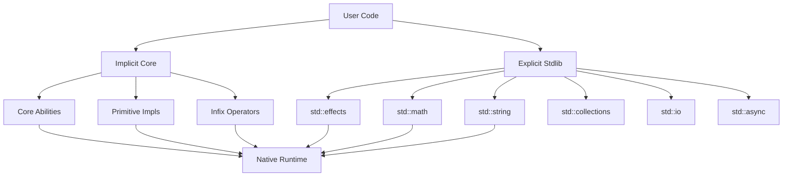

# Standard Library Redesign Design Document

## Overview

This document outlines the redesign of Funk's standard library from scattered native functions into a clean, modular, ability-based system. The new architecture separates implicit core functionality (always available) from explicit standard modules (import required), providing better organization, type safety, and extensibility.

## Architecture

### High-Level Architecture



### Core Components

1. **Implicit Core**: Always available abilities, operators, and primitive implementations
2. **Explicit Stdlib**: Modular libraries that require explicit imports
3. **Native Runtime**: Optimized native implementations for performance-critical operations
4. **Ability System**: Type-safe abstraction over operations

## Components and Interfaces

### 1. Implicit Core System

#### Core Abilities Definition

```funk
# std/core/abilities.funk - Always imported

# Granular numeric abilities (shorter names)
ability NumAdd 'a {
    add: { left: 'a, right: 'a } -> 'a
}

ability NumSub 'a {
    subtract: { left: 'a, right: 'a } -> 'a
}

ability NumMul 'a {
    multiply: { left: 'a, right: 'a } -> 'a
}

ability NumDiv 'a {
    divide: { left: 'a, right: 'a } -> 'a
}

ability NumMod 'a {
    modulo: { left: 'a, right: 'a } -> 'a
}

ability Eq 'a {
    equals: { left: 'a, right: 'a } -> Boolean
}

ability Ord 'a with { Eq 'a } {
    compare: { left: 'a, right: 'a } -> Ordering,
    less_than: { left: 'a, right: 'a } -> Boolean,
    greater_than: { left: 'a, right: 'a } -> Boolean
}

ability Show 'a {
    to_string: { value: 'a } -> String
}

type Ordering = | Less, Equal, Greater |
```

#### Primitive Implementations

```funk
# std/core/primitives.funk - Always imported

# Int implementations (using existing native functions)
impl NumAdd Int {
    add = { left, right } -> add_int { left = left, right = right }
}

impl NumSub Int {
    subtract = { left, right } -> subtract_int { left = left, right = right }
}

impl NumMul Int {
    multiply = { left, right } -> multiply_int { left = left, right = right }
}

impl NumDiv Int {
    divide = { left, right } -> divide_int { left = left, right = right }
}

impl NumMod Int {
    modulo = { left, right } -> modulo_int { left = left, right = right }
}

impl Eq Int {
    equals = { left, right } -> __native_int_equals { left = left, right = right }
}

impl Ord Int {
    compare = { left, right } -> __native_int_compare { left = left, right = right },
    less_than = { left, right } -> __native_int_less_than { left = left, right = right },
    greater_than = { left, right } -> __native_int_greater_than { left = left, right = right }
}

impl Show Int {
    to_string = { value } -> __native_int_to_string { value = value }
}

# Similar implementations for Float, String, Boolean, Nat
```

#### Infix Operators

```funk
# std/core/operators.funk - Always imported

# Numeric operators (polymorphic over specific numeric abilities)
pub let (+) = { left, right } where { NumAdd 'a } -> 
    NumAdd.add { left = left, right = right }

pub let (-) = { left, right } where { NumSub 'a } -> 
    NumSub.subtract { left = left, right = right }

pub let (*) = { left, right } where { NumMul 'a } -> 
    NumMul.multiply { left = left, right = right }

pub let (/) = { left, right } where { NumDiv 'a } -> 
    NumDiv.divide { left = left, right = right }

pub let (%) = { left, right } where { NumMod 'a } -> 
    NumMod.modulo { left = left, right = right }

# Equality operators (polymorphic over Eq types)
pub let (==) = { left, right } where { Eq 'a } -> 
    Eq.equals { left = left, right = right }

pub let (!=) = { left, right } where { Eq 'a } -> 
    not (Eq.equals { left = left, right = right })

# Ordering operators (polymorphic over Ord types)
pub let (<) = { left, right } where { Ord 'a } -> 
    Ord.less_than { left = left, right = right }

pub let (>) = { left, right } where { Ord 'a } -> 
    Ord.greater_than { left = left, right = right }

pub let (<=) = { left, right } where { Ord 'a } -> 
    not (Ord.greater_than { left = left, right = right })

pub let (>=) = { left, right } where { Ord 'a } -> 
    not (Ord.less_than { left = left, right = right })

# Special case: Nat subtraction returns Int
pub let (-) = { left: Nat, right: Nat } -> 
    __native_nat_subtract_to_int { left = left, right = right }
```

### 2. Type-Specific Modules

#### Dedicated Type Modules

Each primitive type has its own module with native implementations and conversion functions:

```funk
# std/types/int.funk - Int operations and conversions
pub let add = { left: Int, right: Int } -> Int
    add_int { left = left, right = right }

pub let from_float = { value: Float } -> Int
    __native_int_from_float { value = value }

pub let from_nat = { value: Nat } -> Int
    __native_int_from_nat { value = value }

pub let abs = { value: Int } -> Int
    if value < 0 then subtract { left = 0, right = value } else value
```

```funk
# std/types/float.funk - Float operations and conversions
pub let add = { left: Float, right: Float } -> Float
    add_float { left = left, right = right }

pub let from_int = { value: Int } -> Float
    __native_float_from_int { value = value }

pub let sqrt = { value: Float } -> Float
    __native_float_sqrt { value = value }
```

```funk
# std/types/string.funk - String operations and conversions
pub let length = { str: String } -> Int
    __native_string_length { str = str }

pub let to_int = { str: String } -> Int
    __native_string_to_int { str = str }

pub let concat = { left: String, right: String } -> String
    __native_string_concat { left = left, right = right }
```

### 3. Explicit Standard Library Modules

#### Effects Module

```funk
# std/effects/io.funk

effect Console {
    print: { msg: String } -> {} <Console>,
    debug: { msg: String } -> {} <Console>
}

effect FileSystem {
    read_file: { path: String } -> String <FileSystem>,
    write_file: { path: String, content: String } -> {} <FileSystem>
}

# Native implementations (not exposed to users)
impl Console for ConsoleHandler {
    print = { msg } -> print { msg = msg },        # Uses existing native
    debug = { msg } -> debug { msg = msg }         # Uses existing native
}

impl FileSystem for FileSystemHandler {
    read_file = { path } -> read_file { path = path },      # Uses existing native
    write_file = { path, content } -> write_file { path = path, content = content }
}
```

#### Math Module

```funk
# std/math/basic.funk

pub let abs = { value } where { Numeric 'a, Ord 'a } -> 
    if value < 0 then Numeric.subtract { left = 0, right = value } else value

pub let min = { left, right } where { Ord 'a } ->
    if left < right then left else right

pub let max = { left, right } where { Ord 'a } ->
    if left > right then left else right

pub let pow = { base: Float, exp: Float } -> 
    __native_float_pow { base = base, exp = exp }

pub let sqrt = { value: Float } -> 
    __native_float_sqrt { value = value }
```

#### String Module

```funk
# std/string/core.funk

pub let length = { str: String } -> 
    __native_string_length { str = str }

pub let substring = { str: String, start: Int, end: Int } -> 
    __native_string_substring { str = str, start = start, end = end }

pub let concat = { left: String, right: String } -> 
    __native_string_concat { left = left, right = right }

pub let split = { str: String, delimiter: String } -> 
    __native_string_split { str = str, delimiter = delimiter }

pub let format = { template: String, args: ArrayList 'a } where { Show 'a } ->
    __native_string_format { template = template, args = args }
```

#### Collections Module

```funk
# std/collections/list.funk

pub let map = { list: ArrayList 'a, func: 'a -> 'b } -> ArrayList 'b
    __native_arraylist_map { list = list, func = func }

pub let filter = { list: ArrayList 'a, predicate: 'a -> Boolean } -> ArrayList 'a
    __native_arraylist_filter { list = list, predicate = predicate }

pub let fold = { list: ArrayList 'a, initial: 'b, func: { acc: 'b, item: 'a } -> 'b } -> 'b
    __native_arraylist_fold { list = list, initial = initial, func = func }

pub let length = { list: ArrayList 'a } -> Int
    __native_arraylist_length { list = list }
```

### 3. Native Runtime Integration

#### Native Function Registry

```kotlin
// StdLibNativeImplementations.kt - All __native_ functions hidden from user code
object StdLibNativeImplementations {
    
    fun registerAll(context: MutableMap<String, FunkValue>) {
        registerIntOperations(context)      // __native_int_*
        registerFloatOperations(context)    // __native_float_*
        registerStringOperations(context)   // __native_string_*
        registerBooleanOperations(context)  // __native_boolean_*
        registerNatOperations(context)      // __native_nat_*
        registerConsoleOperations(context)  // __native_console_* (hidden print/debug)
        registerFileSystemOperations(context) // __native_fs_*
        registerMathOperations(context)     // __native_math_*
        registerArrayListOperations(context) // __native_arraylist_*
    }
    
    private fun registerConsoleOperations(context: MutableMap<String, FunkValue>) {
        // Hidden from user code - only accessible through effects
        context["__native_console_print"] = SimpleFunkFunction { args ->
            val msg = (args["msg"] as FunkString).value
            print(msg)
            FunkUnit
        }
        
        context["__native_console_debug"] = SimpleFunkFunction { args ->
            val msg = (args["msg"] as FunkString).value
            System.err.println("[DEBUG] $msg")
            FunkUnit
        }
    }
    
    private fun registerStringOperations(context: MutableMap<String, FunkValue>) {
        context["__native_string_length"] = SimpleFunkFunction { args ->
            val str = (args["str"] as FunkString).value
            FunkInt(str.length.toLong())
        }
        
        context["__native_string_to_int"] = SimpleFunkFunction { args ->
            val str = (args["str"] as FunkString).value
            try {
                FunkInt(str.toLong())
            } catch (e: NumberFormatException) {
                throw RuntimeException("Cannot convert '$str' to Int")
            }
        }
        
        // ... more string operations
    }
}
```

### 4. TypeChecker Integration

#### Automatic Core Import

```kotlin
// TypeChecker.kt
class TypeChecker {
    
    private fun registerStdLibTypes() {
        // Always import core abilities and operators
        importCoreAbilities()
        importPrimitiveImplementations()  
        importInfixOperators()
        
        // Register native function signatures
        StdLibNativeRegistry.registerTypeSignatures(context)
    }
    
    private fun importCoreAbilities() {
        // Import std/core/abilities.funk automatically
        val abilitiesModule = moduleResolver.resolveModule("std::core::abilities")
        processModuleImports(abilitiesModule)
    }
    
    private fun importPrimitiveImplementations() {
        // Import std/core/primitives.funk automatically
        val primitivesModule = moduleResolver.resolveModule("std::core::primitives")
        processModuleImports(primitivesModule)
    }
    
    private fun importInfixOperators() {
        // Import std/core/operators.funk automatically
        val operatorsModule = moduleResolver.resolveModule("std::core::operators")
        processModuleImports(operatorsModule)
    }
}
```

### 5. Parser Integration

#### Infix Operator Desugaring

```kotlin
// FunkParserImpl.kt
class FunkParserImpl {
    
    override fun visitBinaryOperation(ctx: BinaryOperationContext): Expression {
        val left = visit(ctx.left) as Expression
        val right = visit(ctx.right) as Expression
        val operator = ctx.operator.text
        
        // Desugar infix operators to function calls
        return when (operator) {
            "+" -> FunctionCall(
                function = Identifier("(+)"),
                arguments = RecordExpression(listOf(
                    RecordEntry("left", left),
                    RecordEntry("right", right)
                ))
            )
            
            "-" -> FunctionCall(
                function = Identifier("(-)"),
                arguments = RecordExpression(listOf(
                    RecordEntry("left", left),
                    RecordEntry("right", right)
                ))
            )
            
            // ... other operators
            
            else -> throw ParseException("Unknown operator: $operator")
        }
    }
}
```

## Implementation Strategy

### Phase 1: Core Abilities Framework
1. Create `std/core/` directory structure
2. Implement core abilities (Numeric, Eq, Ord, Show)
3. Create primitive implementations for Int, Float, String, Boolean, Nat
4. Implement infix operator desugaring in parser
5. Update TypeChecker to auto-import core modules

### Phase 2: Native Runtime Integration
1. Port existing stdlib implementations (NumericAbilities.kt, StringAbilities.kt, etc.)
2. Integrate existing native functions with new __native_ hiding mechanism
3. Update existing StdLib.kt to work with new ability-based architecture
4. Preserve existing functionality while adding new ability system
5. Add comprehensive error handling and validation

### Phase 3: Standard Library Modules
1. Create `std/effects/` modules with I/O, async, random effects
2. Create `std/math/` modules with mathematical functions
3. Create `std/string/` modules with string operations
4. Create `std/collections/` modules for data structures
5. Create `std/io/` modules for file and network I/O

### Phase 4: Integration & Testing
1. Update module resolution to handle std:: imports
2. Create comprehensive test suite for all modules
3. Add performance benchmarks
4. Create migration guide from old stdlib

### Phase 5: Documentation & Examples
1. Create comprehensive API documentation
2. Add usage examples and tutorials
3. Create best practices guide
4. Add IDE support for stdlib modules

## Error Handling

### Compile-Time Validation
- Ability constraint checking for operators
- Missing implementation detection
- Type safety validation for native calls

### Runtime Error Handling
- Graceful handling of native operation failures
- Clear error messages for ability constraint violations
- Safe fallbacks for I/O and system operations

## Performance Considerations

### Native Optimization
- Direct native calls for primitive operations
- Truffle specialization for hot paths
- Minimal overhead for ability dispatch

### Memory Management
- Efficient representation of primitive values
- Lazy loading of standard library modules
- Optimal memory usage for collections

## Security Considerations

### Native Function Isolation
- All functions starting with `__native_` are hidden from user code
- No direct `print` or `debug` exposure - only through effects
- Secure wrappers for system operations through dedicated Kotlin implementations
- Sandboxed execution for effects

### Effect System Integration
- Safe I/O operations through effect system
- Controlled access to system resources
- Clear separation of pure and effectful operations

This design provides a clean, extensible, and type-safe foundation for Funk's standard library while maintaining performance and security.